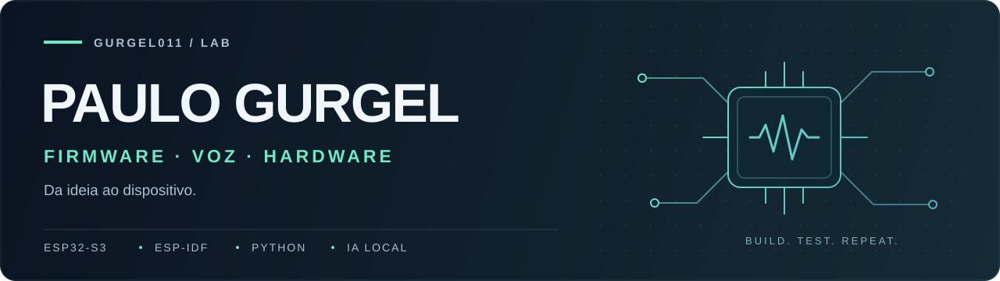

  

  <strong>Software que ganha voz, tela e vida fora do computador.</strong>

  <a href="#projetos">Projetos</a> ·
  <a href="#tecnologias">Tecnologias</a> ·
  <a href="#por-onde-começar">Por onde começar</a>

## Olá, eu sou o Paulo 👋

Desenvolvo projetos com **ESP32, assistentes de voz locais e interfaces para dispositivos**. Gosto de conectar firmware, áudio e automação — do protocolo serial à experiência na tela. Também construo experiências para a web.

## Projetos

### Voz e inteligência artificial local

| Projeto | O que você encontra |
| :--- | :--- |
| **[Antena 1 · Assistente de voz](https://github.com/Gurgel011/antena1-voice-assistant)** | Firmware customizado a partir do **xiaozhi-esp32**, com servidor local em Python: **Whisper → Ollama → Piper**. [Guia de configuração](https://github.com/Gurgel011/antena1-voice-assistant/blob/main/ANTENA1_SETUP.md). |
| **[Voice PE · Firmware em português](https://github.com/Gurgel011/paulo-voice-pe-firmware)** | Firmware próprio para o hardware Home Assistant Voice PE, com API HTTP, botão e dial. **Protótipo em evolução**, com integração de áudio prevista nas próximas etapas. |

### Firmware e interfaces

| Projeto | O que você encontra |
| :--- | :--- |
| **[Antena 1 · Fullscreen OS](https://github.com/Gurgel011/antena1-fullscreen-os)** | Rádio ao vivo no **ESP32-S3**, interface **LVGL 9** em tela AMOLED, rosto animado e indicadores de conexão e volume. |
| **[PhotoPainter · ESP32-S3](https://github.com/Gurgel011/esp32-s3-photopainter-paulo)** | Base independente em **ESP-IDF** para o PhotoPainter da Waveshare. Projeto em etapas para explorar tela, conectividade e áudio. |

### Laboratório e web

| Projeto | O que você encontra |
| :--- | :--- |
| **[Botão Lab](https://github.com/Gurgel011/botao-lab)** | Ferramentas em **Python** para captura e análise de **UART**, calibração de touch e automações com controles físicos. |
| **[Iranildo · Site pessoal](https://github.com/Gurgel011/iranildo-site)** | Site sobre a trajetória do zagueiro Iranildo, com carreira, títulos, vídeos e galeria. **Vite, JavaScript, CSS e Anime.js**. |

## Tecnologias

| Área | Ferramentas |
| :--- | :--- |
| **Embarcados** | ESP32-S3 · ESP-IDF · C · C++ · LVGL |
| **Voz e IA local** | Python · Whisper · Ollama · Piper |
| **Integrações** | UART · I²C · I²S · HTTP · WebSocket |
| **Web** | HTML · CSS · JavaScript · Vite · Anime.js |

## Por onde começar

- **Quero explorar voz local:** [configuração da Antena 1](https://github.com/Gurgel011/antena1-voice-assistant/blob/main/ANTENA1_SETUP.md).
- **Quero ver firmware com interface:** [Antena 1 Fullscreen OS](https://github.com/Gurgel011/antena1-fullscreen-os#readme).
- **Quero investigar um dispositivo:** [captura e análise no Botão Lab](https://github.com/Gurgel011/botao-lab#readme).
- **Quero conhecer o projeto web:** [Site do Iranildo](https://github.com/Gurgel011/iranildo-site#readme).

---

  Explore os READMEs para ver hardware, configuração e o estágio de cada projeto.

